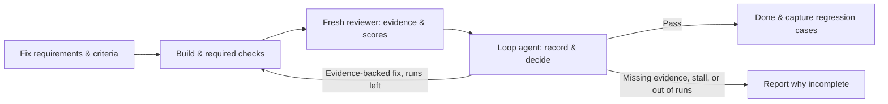

# AI Agent

> 한국어 사용자: 문서는 영어로 작성돼 있으며, 에이전트는 사용자가 쓰는 언어로 답한다.

**A set of Claude Code / Codex settings that hands planning, building, and verification to the model that fits each job, and keeps evaluation evidence for the next improvement.**

Planning runs at `high`, building at `medium`, and simple execution at each model's officially recommended level (Sonnet 5.5 `medium`, Luna `high`). Results are judged by a separate top-model subagent run at `xhigh`. Instead of trusting the working agent's explanation, the reviewer re-checks the requirements and the actual changed files first.

The desktop session mission-control kit lives in a separate repo: [claudi](https://github.com/mingeonho1/claudi).

## Model assignment

| Role | Claude Code | Effort | Codex | Effort |
| --- | --- | --- | --- | --- |
| Planning · deep judgment | **Fable 5.1** · `claude-fable-5-1` | high | **Astra** · `gpt-6-astra` | high |
| Builder | Opus 5.5 · `claude-opus-5-5` | medium | Sol · `gpt-6-sol` | medium |
| Execution helper | Sonnet 5.5 · `claude-sonnet-5-5` | medium | Luna · `gpt-6-luna` | high |
| Independent verification | **Fable 5.1** · fresh subagent | **xhigh** | **Astra** · fresh subagent | **xhigh** |
| Evaluation record · improvement proposals | Opus 5.5 · `ai-loop` | medium | Sol · `ai_loop` | medium |

"One level higher" for verification is measured against planning's `high`. This table is this repo's operating choice. Effort names do not mean the same amount of thinking across model generations, so recalibrate when you change models ([effort docs](https://platform.claude.com/docs/en/build-with-claude/effort)). Check model support in the [official sources](docs/harness.md) and on the account you run. Do not silently swap a model you cannot use.

A setup that drops the top-tier models and only tunes effort is in [Token-efficient mode](#token-efficient-mode).

## Token-efficient mode

An optional setup that assumes current models are good enough, drops the top-tier models (Fable 5.1 · Astra), and only tunes effort. Role bodies are the same; install only rewrites the model and effort lines of the role files.

| Role | Claude Code | Effort | Codex | Effort |
| --- | --- | --- | --- | --- |
| Planning · deep judgment | Opus 5.5 · `claude-opus-5-5` | high | Sol · `gpt-6-sol` | high |
| Builder | Opus 5.5 · `claude-opus-5-5` | medium | Sol · `gpt-6-sol` | medium |
| Execution helper | Sonnet 5.5 · `claude-sonnet-5-5` | low | Luna · `gpt-6-luna` | medium |
| Independent verification | Opus 5.5 · fresh subagent | **xhigh** | Sol · fresh subagent | **xhigh** |
| Red team | Opus 5.5 · `ai-red-team` | **xhigh** | Sol · `ai_red_team` | **xhigh** |
| Evaluation record · improvement proposals | Opus 5.5 · `ai-loop` | low | Sol · `ai_loop` | low |

The rule of verifying one level above planning still holds. Install with `--mode eco`; it combines with the other options.

```bash
python3 scripts/install.py claude --user --mode eco
python3 scripts/install.py codex --user --mode eco
python3 scripts/install.py claude --user --package red-team --mode eco
claude --model claude-opus-5-5 --effort medium
```

Role files already installed in standard mode differ in content, so the install stops on a collision. Move the existing files and install again. If planning conflicts become frequent or reviews start missing defects, go back to standard. Savings have not been measured yet.

## Claude Code setup

Requires Python 3.9 or later. Clone the repo and install only the platform you use.

```bash
git clone https://github.com/mingeonho1/ai-agent.git
cd ai-agent
python3 scripts/install.py claude --user
```

Default paths: the Skill goes to `~/.claude/skills/claude-agent-operations/` and the five roles to `~/.claude/agents/`. The evaluation-loop Skill `agent-evaluation-loop` is installed too. If `CLAUDE_CONFIG_DIR` is set, the Skill, roles, and optional hook settings go under that folder. Start a new Claude Code session and make requests with `/claude-agent-operations`.

```bash
claude --model claude-fable-5-1 --effort high
```

If `CLAUDE_CODE_EFFORT_LEVEL` is set, it can override each agent's effort. Use these role settings in a session where that variable is unset. Fable 5.1 needs Claude Code 2.1.257 or later; Opus 5.5 and Sonnet 5.5 need the latest version (`claude update`). [Model config](https://code.claude.com/docs/en/model-config)

## Codex setup

Run the following from the same repo. GPT-6 Sol and Luna need Codex CLI 0.157.0 or later.

```bash
python3 scripts/install.py codex --user
codex --model gpt-6-astra -c 'model_reasoning_effort="high"'
```

The Skill goes to `~/.agents/skills/codex-agent-operations/` and the five roles to `${CODEX_HOME:-~/.codex}/agents/`. The evaluation-loop Skill `agent-evaluation-loop` is installed too. In a new Codex session, make requests with `$codex-agent-operations`. The role files' model and effort values apply to subagent runs; copying the Skill alone does not change models. See [`codex/config.example.toml`](codex/config.example.toml) to set `[agents] max_concurrent_threads_per_session = 3` and `review_model`. Profiles live in `~/.codex/<name>.config.toml` and are selected with `--profile <name>` (format since 0.134.0).

## Per-project setup

Instead of a global install, you can register into a single project. Both platforms can be installed into the same project.

```bash
python3 scripts/install.py claude --project /absolute/path/to/project
python3 scripts/install.py codex --project /absolute/path/to/project
```

| Platform | Skill | Subagents |
| --- | --- | --- |
| Claude Code | `.claude/skills/` | `.claude/agents/*.md` |
| Codex | `.agents/skills/` | `.codex/agents/*.toml` |

Use `--dry-run` to check paths first. Reinstalling leaves identical files alone; if different content already exists, the installer stops instead of overwriting. If you previously installed `skills/claude-agent-operations` into Codex, use the new Codex Skill and disable or remove the old copy in that app.

## Only the harness you need

| Claude Code | Codex |
| --- | --- |
| A Markdown agent per role with `model`, `effort`, and the `tools` it needs | A TOML agent per role with `model` and `model_reasoning_effort` |
| `ai-reviewer` runs as a fresh named subagent, separate from the build conversation. `ai-loop` and `ai-red-team` preload rubrics/checklists via `skills:`; `ai-reviewer` starts in a fresh context with no preload or memory | `ai_reviewer` runs in a fresh, non-inherited context. Every review opens a new thread with `spawn_agent`, never `resume_agent` |
| Per-task handoff documents, optional post-compaction reminder hook | A short Skill entry point that reads only the references it needs; no default hooks added |

On both platforms, independent work runs in parallel and only one agent writes a given file. Verification starts after files are stable. If fixes follow, a new reviewer re-verifies the affected scope. If a non-inherited context cannot be confirmed or separate verification did not run, report independent verification as incomplete. If the reviewer asks for more execution evidence, the execution helper runs the checks and the reviewer judges the result.

Add the option below only if Claude often loses the handoff after compaction. It keeps the other settings in your existing `settings.json` and adds a short reminder to the `compact` event of `SessionStart`. It does not call a model or collect full transcripts.

```bash
python3 scripts/install.py claude --user --with-context-hook
```

## Evaluate-and-improve loop

`ai-loop` / `ai_loop` records the reviewer's evaluation and proposes the next fix scope. A fresh independent reviewer assigns scores with evidence; a Python script computes totals and the stop decision. The main agent does the actual fixes and re-evaluation calls. This stop mechanism matches the "verification subagent" gate (so the agent that did the work does not grade itself) among the four loop-exit gates in Claude Code's official [best-practices](https://code.claude.com/docs/en/best-practices); `/goal` and the Stop hook are optional.



| Criterion | Weight | What it checks |
| --- | --- | --- |
| Intent fit | 30% | Does it meet the requested outcome and constraints? |
| Correctness | 30% | Do actual behavior and facts hold? |
| Verification evidence | 20% | Are claims backed by matching checks and run evidence? |
| Readability | 10% | Can the next user or worker understand and use it? |
| Efficiency | 10% | Did it avoid unnecessary changes, tool calls, and repetition? |

Each criterion is scored 0–4 against observable conditions. The default pass bar is **total ≥ 85, every criterion ≥ 3, required checks pass, no confirmed high/medium findings, and independent verification confirmed**. Without evidence, scores are not guessed. Criteria are fixed before starting; if they change, create a new version and baseline.

At most 3 runs, including the first evaluation. Iterations where the score moves but the same problem stays unsolved do not count as improvement. Previous scores and the builder's explanation are not passed to the new reviewer; the original requirements, criteria, current output, and verification evidence are provided every time. Per-task records go in `runs/<task-id>/`. Verified lessons go in the project's `evals/lessons/` with applicability, reproduction steps, and expected results, and the next planning pass looks up related cases and adds them as checks in the new baseline.

These weights and limits are this repo's defaults. Until calibrated against human-judged examples, scores are provisional. The [loop Skill, criteria, and scripts](evaluation-loop/skills/agent-evaluation-loop/) define the exact formats.

## Red team that doubts plans and code

[red-team/](red-team/) installs separately. It reviews plan assumptions and code failure conditions from the opposing side and returns **high/medium/low impact**, evidence, confidence, and how to re-verify. It does not rewrite the plan on its own or turn suspicions into confirmed defects.

```bash
python3 scripts/install.py claude --user --package red-team
python3 scripts/install.py codex --user --package red-team
```

Claude uses a fresh Fable 5.1 xhigh `ai-red-team`; Codex uses a fresh Astra xhigh `ai_red_team`. Request it with `/adversarial-review` in Claude or `$adversarial-review` in Codex. Use `--package all` to install it together with the operations setup. `--project` and `--dry-run` are supported too.

The red team finds counterexamples; the final reviewer judges that evidence. The [scope borrowed from Petri and Bloom](red-team/skills/adversarial-review/references/sources.md) is documented. This repo's Skill does not install either project's full framework.

## Dual-account split

[dual-account/](dual-account/) splits two Claude accounts by role. The main account (app/CLI) only plans, judges, and synthesizes results; token-heavy building, testing, and research run headless on the second account's CLI, which returns only the final report. Only login is separated; sessions, settings, roles, and Skills are shared with `~/.claude`.

```bash
bash dual-account/setup.sh
claude2                      # first time only: /login with the second account
alt-agent ai-builder <<'EOF'
Goal, target files, done criteria, report format
EOF
```

Combined with token-efficient mode, the main account plans with Opus 5.5 `medium` while execution roles run on the second account. Headless runs skip permission prompts, so use them only in repos you trust. Details and caveats are in [dual-account/README.md](dual-account/README.md).

## Optional add-ons

- [fable-mode/](fable-mode/) — Fable orchestration mode. The main agent only plans, routes, and judges; a PreToolUse gate caps direct code edits and pushes execution to subagents. Toggle with `fable on` / `fable off`. It costs more tokens than the default setup.
- [extras/](extras/) — general-purpose subagents: `diff-code-reviewer` (reviews only the diff) and `skill-evaluator` (grades a SKILL.md).
- [examples/patsol/](examples/patsol/) — a real company profile (skills, routines, automations) kept as a worked example of how one team customized Claude Code. Company values are filled in by answering questions; nothing company-specific is hardcoded.

## Contents and sources

- [Claude Skill](claude/skills/claude-agent-operations/SKILL.md) · [Claude role settings](claude/agents/) · [Optional hook](claude/hooks/compact-reminder.json)
- [Codex Skill](codex/skills/codex-agent-operations/SKILL.md) · [Codex role settings](codex/agents/)
- [Techniques taken from official docs and their scope](docs/harness.md)
- [Evaluation loop rationale and scope](docs/evaluation.md)
- [Economic news card maker](https://github.com/mingeonho1/economic-news-card-skill) is a separate repo.

Token savings and quality gains have not been measured yet. Model, effort, run time, and verification results are recorded per task to tune the setup.
