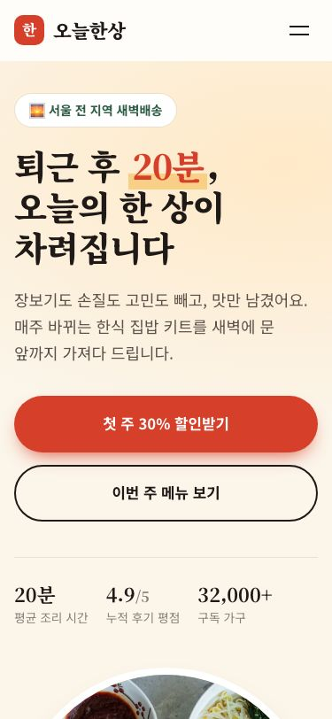

# Web design review bundle

Two read-only Skills that measure a web page or app screen and report a number, so "is this good enough to show?" has an answer you can repeat. Register it separately from the operations agents.

- `design-review`: UI review. Returns 상/중/하 (high/medium/low) findings, a 0–100 score, and pass/fail for the `poc`, `beta` or `prod` bar.
- `seo-geo-review`: deterministic SEO + GEO (AI-search citability) score from the raw HTML, with the same 상/중/하 findings and bars.

Neither Skill edits project source. Reports written by `score.py` and `seo_check.py` are in Korean; the Skills, rubrics and reviewer agents are in English. Findings are tagged 상/중/하 in the report; they map to Hallmark's Floor/Reflex/Finish.

## Install

Run from the repository root.

```bash
python3 scripts/install.py claude --user --package web-design
python3 scripts/install.py codex --user --package web-design
```

To install into a specific project, use `--project PATH` instead of `--user`. `--package all` installs it with the operations and red-team packages.

Invoke with `/design-review` and `/seo-geo-review` in Claude, `$design-review` and `$seo-geo-review` in Codex. `design-review` needs the reviewer agent from this package: `design-reviewer` in Claude, `design_reviewer` in Codex. It runs two fresh, independent read-only instances and never reviews in the conversation that built the page. Requires Python 3.9 or later; both scripts use only the standard library.

Optional: a browser tool (Playwright MCP, Claude Browser or Claude in Chrome) lets the reviewer open the page at 1440/768/375 widths and press the controls. [Hallmark](https://github.com/Nutlope/hallmark) `sloplint` adds a rule-based lint pass, and `puppeteer-core` plus Chrome adds screenshots. Without them the Skill says so and continues.

## Usage

```
/design-review                                    # changed UI files, poc bar
/design-review http://localhost:3000 --bar beta   # a running dev server
/design-review src/app/dashboard --app --bar prod # app screen (marketing-only rules skipped)
/seo-geo-review site/ --bar beta                  # folder with index.html
/seo-geo-review https://example.com --bar prod    # deployed URL
```

The scripts can also run directly:

```bash
python3 web-design/skills/design-review/scripts/score.py --review review-a.json --review review-b.json --bar poc
python3 web-design/skills/seo-geo-review/scripts/seo_check.py --target <html|dir|url> --bar poc
```

Exit codes: 0 bar met, 1 bar not met, 2 bad input. Results accumulate under `.design-review/` and `.seo-geo-review/`, so reruns show a trend such as `추이: 51 → 68 → 76`. A lone review JSON also works and is reported as single-run.

## How scoring works

Design score, computed only by `score.py` (same input, same score):

```
UX (50)       = Nielsen's 10 heuristics, 0–4 each (n/a excluded), as a ratio × 50
Polish (50)   = 50 − (10 per 상 + 4 per 중 + 1 per 하)
Total         = UX + Polish
```

SEO + GEO score, computed only by `seo_check.py` from 30 checks on the raw HTML (no JS is run, because most AI crawlers do not run it): `technical 25 + on-page 20 + structured data 15 + GEO 25 + performance 15 = 100`. It fetches only the target and `/robots.txt`, `/sitemap.xml`, `/llms.txt`.

| Bar | Use | Design passes when | SEO + GEO passes when |
| --- | --- | --- | --- |
| `poc` (default) | PoC, internal demo | 0 상, score ≥ 70 | 0 상, score ≥ 60 |
| `beta` | external beta, pilot | 0 상, ≤ 3 중, score ≥ 80 | 0 상, ≤ 3 중, score ≥ 75 |
| `prod` | public launch | 0 상, 0 중, score ≥ 90, 0 product decisions | 0 상, 0 중, score ≥ 90 |

One 상 fails the bar whatever the score. Severity definitions, the concrete tells, the mobile checklist and the waiver format are in [design-review/rubric.md](skills/design-review/rubric.md); the 30 SEO/GEO checks are in [seo-geo-review/rubric.md](skills/seo-geo-review/rubric.md). Waivers live in `.design-review/waivers.md` as `- <gate id>: <reason, 10+ chars>`; a 상 cannot be waived.

Design choices: the reviewer reports everything at its honest severity and the script does the filtering; "don't look AI-made" is replaced by a list of named tells; a typeface choice is never a finding.

## Overfitting safeguards

Fixing a page to one review's wording tends to add a new tell, and a single review can swing the same page by about ±10 points. So:

| Safeguard | Behavior |
| --- | --- |
| Two independent runs | Two reviewers run in parallel without seeing each other. A 상 counts only when both flag the same issue (same gate id or same `file:line`) as 상; otherwise it counts as 중 and is listed as "needs recheck". The total is the mean of the two runs |
| Product decisions set apart | Backend wiring, real photos, legal text and real contacts cannot be fixed by design. Such 중/하 are `kind: product`, listed separately and left out of the score; only `prod` blocks on them. A 상 is never a product decision |
| Fix to the rubric, not the report | The fixer gets the findings plus the rubric's 상 lines as hard constraints and checks its own diff against them. Smallest change, no copy written to please a reviewer. Stop after two rounds with no gain in the two-run mean |

## Experiment summary

One Korean meal-kit landing page ("오늘한상") was built by Sonnet 5.5, then reviewed each round by fresh Opus instances; the fixer received only the report each round.

- v1: built with no rubric and no Skill. **33 (F), 11 상.** It looked finished but had a form that showed "success" without sending anything, invented figures and named testimonials, one checkbox bundling privacy and marketing consent, a keyboard trap in the mobile menu, and emoji icons.
- v2–v7: each round fixed the last report. Fixing to report wording created new defects (v5 repeated filler copy; v6 disabled a form with `opacity` only, a new 상, scored 50 on both reviews). Those two failures became the safeguards above. v7 added the two-run consensus and the rubric 상 list as constraints.
- v7: **82 (B)**, 0 상 / 1 중 / 5 하, mean of 85 and 78, both reviewers `ship`, passes `poc` and `beta`. SEO + GEO went from 72 (C) to 95 (A). Three product decisions remain (a place to receive sign-ups, operator and contact details, real kit photos); they are excluded from the score, which would be 74 without that separation.

| | v1 | v7 |
| --- | --- | --- |
| Design score | 33 F (11 상 · 11 중 · 5 하) | **82 B** (0 상 · 1 중 · 5 하) |
| SEO + GEO | 72 C | **95 A** |
| Reviewer verdict | fix | both **ship** |

Desktop (1440×900)

| v1 | v7 |
| --- | --- |
|  |  |

Mobile (375×812)

| v1 | v7 |
| --- | --- |
|  |  |

## Limits

- One page, one builder model, one reviewer model. The scores show the loop moves a page in the right direction; they are not a calibrated measure of design quality.
- Two runs shrink reviewer noise but do not remove it. Treat a few points of difference as noise.
- Without a browser tool the reviewer judges from source and says so in `limits`; measured items (touch targets, input font size, first viewport) then become estimates.
- `seo-geo-review` is rule-based: it approximates sentence quality, never sees the rendered DOM, external CSS/JS or real image weight, and only reports whether `sitemap.xml` exists.
- Reports are Korean only.

## Sources

Tier model and gate ids from [Nutlope/hallmark](https://github.com/Nutlope/hallmark) (MIT); heuristic scoring and P0–P3 from [pbakaus/impeccable](https://github.com/pbakaus/impeccable) (Apache-2.0); live review steps and categories from [OneRedOak/claude-code-workflows](https://github.com/OneRedOak/claude-code-workflows) (MIT); anti-slop tells from oh-my-design (MIT). SEO/GEO checks follow Google Search Central, the Open Graph protocol, schema.org, llmstxt.org, the AI crawlers' own documentation (GPTBot, OAI-SearchBot, ClaudeBot, PerplexityBot, Google-Extended) and web.dev. Wording is rewritten, not copied.
